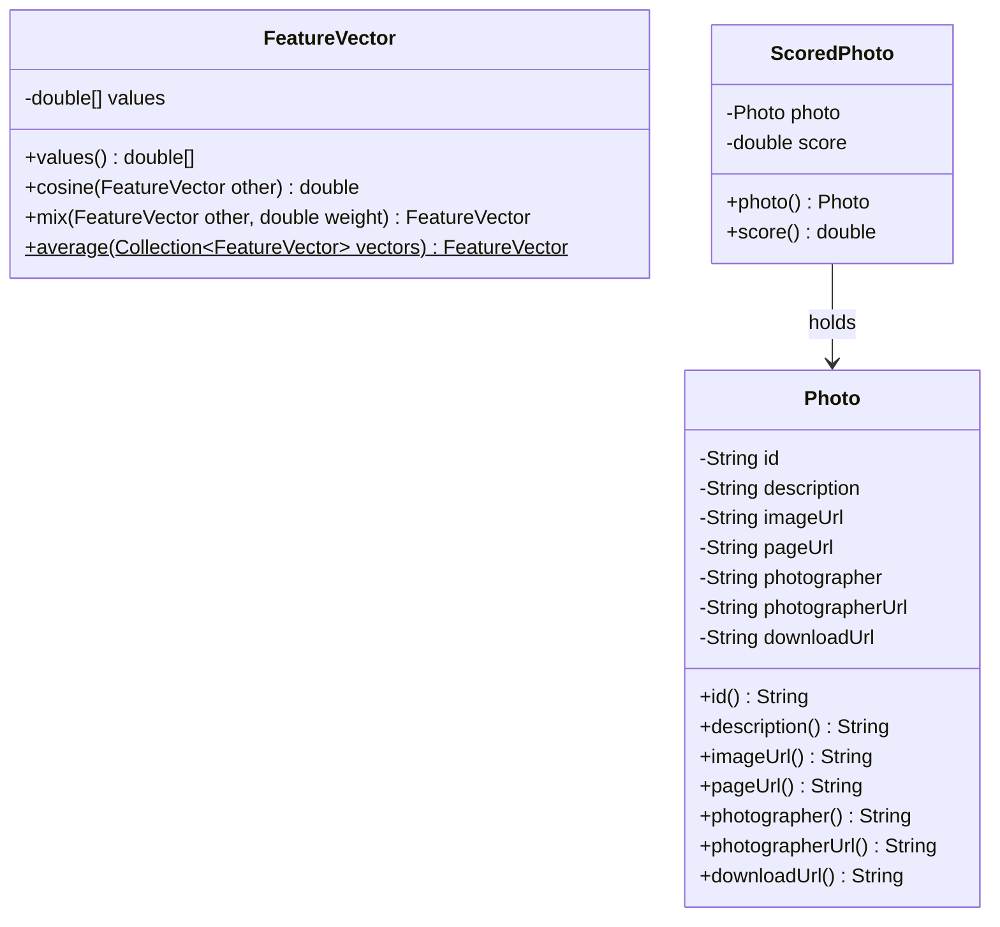

# Team Project

Please keep this up-to-date with information about your project throughout the term.

The readme should include information such as:
- a summary of what your application is all about
- a list of the user stories, along with who is responsible for each one
- information about the API(s) that your project uses 
- screenshots or animations demonstrating current functionality

By keeping this README up-to-date,
your team will find it easier to prepare for the final presentation
at the end of the term.

# Team Project – Pinterest-Inspired Image Discovery Application

## Project Overview

Our project is a Pinterest-inspired application developed using **Java and Java Swing**. The application allows users to search for images, save and organize images into boards, customize their profiles, and receive personalized image recommendations.

Unlike traditional image browsing applications, our project aims to provide recommendations based on the visual preferences of individual boards. Users can discover images that match their interests and organize them into collections.

## User Stories

| ID | User Story | Responsible |
|---|---|---|
| 1 | As a user, I want to create an account and log in so that my boards and preferences are associated with my profile. | Matthew |
| 2 | As a user, I want to search and browse images so that I can discover inspiration for my projects. | Kevin |
| 3 | As a user, I want personalized recommendations based on my board's preferences so that I can discover images relevant to my interests. | Kevin |
| 4 | As a user, I want to create, view, and edit individual pins, including their titles, descriptions, images, and tags, so that I can manage saved content. | Alex |
| 5 | As a user, I want to create, view, and edit boards so that I can organize images by topic. | Gabriel |
| 6 | As a user, I want to customize my profile and appearance settings so that I can personalize my experience. | Kieran & Matthew |

## Main Features

### 1. Account Management
Users can register, log in, and access their saved boards and preferences through their accounts.

### 2. Image Search and Browsing
Users can search for images using keywords, such as "Japanese interior design." Search results are retrieved from the Unsplash API and displayed in an image grid.

The standalone discovery app supports pagination, orientation filters, and sorting by relevance or newest first.

### 3. Personalized Recommendations
The application will recommend images based on the visual characteristics of pins saved to a particular board.

Image features will be represented as numerical vectors, and cosine similarity will be used to rank candidate images based on their similarity to a board's preferences.

The standalone discovery app includes Taste Mixer, which blends two saved preferences using a slider. It also includes group recommendations and board analysis. These features currently use demo preferences. Connecting them to the team’s accounts and saved pins is still pending.

### 4. Pin Management
Users can create, view, and edit pins. Each pin contains information such as:

- Image URL
- Title
- Description
- Tags
- Source information

Pin information will be stored locally using JSON files.

### 5. Board Management
Users can create, view, rename, and delete boards to organize saved pins by topic.

For example, a board titled "Japanese Architecture" could contain pins featuring minimalist interiors, wooden houses, and traditional Japanese buildings.

### 6. Profile Customization
Users can customize their profiles through features such as display names, biographies, avatars, banners, themes, fonts, and appearance settings.

## Domain Entities

These classes are part of the discovery module currently on the team branch. Add the team's account, board, and pin entities here once their class definitions are confirmed.

### Photo

Represents an image from Unsplash and the information needed to display and credit it.

* Fields (all String): `id`, `description`, `imageUrl`, `pageUrl`, `photographer`, `photographerUrl`, and `downloadUrl`.
* Methods: `id()`, `description()`, `imageUrl()`, and `pageUrl()` return the image details. `photographer()` and `photographerUrl()` provide attribution. `downloadUrl()` returns the endpoint for tracking selection.

### FeatureVector

Stores the numerical features that the app uses to compare images.

* Field: `values` is a `double[]` containing the normalized features.
* Methods: `values()` returns a copy. `cosine(other)` compares two vectors, `mix(other, weight)` blends two vectors, and the static method `average(vectors)` combines a collection of vectors into one.

### ScoredPhoto

Pairs a photo with the similarity score used to rank it.

* Fields: `photo` is a `Photo`, and `score` is a `double`.
* Methods: `photo()` and `score()` return the photo and its score.

## APIs

### Unsplash API

**Documentation:** https://unsplash.com/documentation

The application uses the Unsplash API to retrieve images based on user search queries.

The API provides image metadata, including:

| Attribute | Purpose |
|---|---|
| `id` | Unique image identifier |
| `description` | Image description |
| `urls.regular` | URL used to display the image |
| `created_at` | Image upload date |
| `likes` | Number of likes on Unsplash |
| `user` | Photographer information and attribution |

**Example Search Workflow:**

1. User enters "Japanese interior design" into the search bar.
2. The application sends a request to the Unsplash API.
3. Unsplash returns matching images and associated metadata.
4. The application processes the response.
5. Images are displayed in a grid using Java Swing.

## Technologies

| Technology | Purpose |
|---|---|
| Java | Main programming language |
| Java Swing | Graphical user interface |
| Unsplash API | Image search and retrieval |
| JSON | Local storage of user, board, and pin data |
| JUnit | Unit testing |
| Git & GitHub | Version control and team collaboration |
| RGB histogram or optional CLIP with ONNX Runtime | Represents images as vectors for recommendations |

## Data Storage

The application uses local JSON files to store application data.

| File | Responsible | Information Stored |
|---|---|---|
| `users.json` | Matthew | User accounts and authentication information |
| `profiles.json` | Kieran | User profiles and appearance preferences |
| `pins.json` | Alex | Saved pin information and metadata |
| `boards.json` | Gabriel | Boards, ownership, and associated pins |
| `likes.json` | TBD | User likes and application-specific popularity |

A shared JSON utility will be used to read and write persistent data.

## Application Architecture

The project follows Clean Architecture principles to separate business logic, data access, and the user interface.

The main components include:

- **Entities:** Users, Pins, Boards, UserProfiles
- **Use Cases:** Authentication, Image Search, Recommendations, Pin Management, Board Management, Profile Customization
- **Data Access:** JSON repositories and Unsplash API integration
- **User Interface:** Java Swing components

## Running Kevin's search and recommendation module

Stories 2 and 3 now have a standalone Java Swing implementation. It includes Unsplash search with pagination/orientation/order controls, persistent preference samples, cosine recommendations, Taste Mixer, multi-user group ranking and board-preference outlier analysis.

Set `UNSPLASH_ACCESS_KEY` in your terminal, then run `mvn test` and `mvn compile exec:java` with JDK 17 and Maven. Default embeddings use a clearly labelled RGB histogram; an optional CLIP ONNX adapter is available via `CLIP_MODEL_PATH`. The CLIP model is not bundled.

See [Kevin's setup, demo, architecture, team integration and verification guide](docs/KEVIN_DISCOVERY.md). This module leaves accounts, board/pin CRUD and profiles to their assigned owners.
