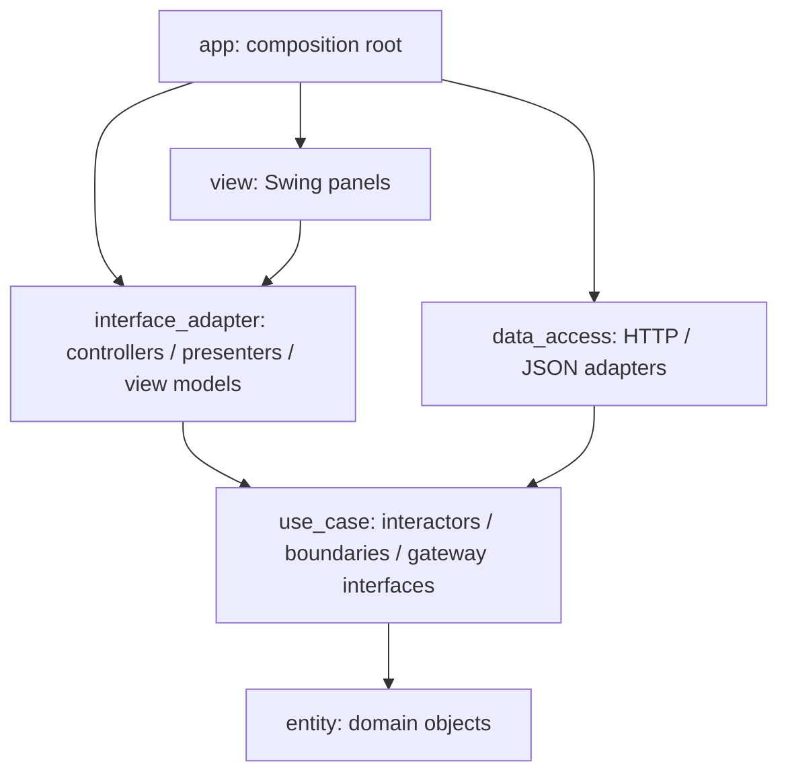
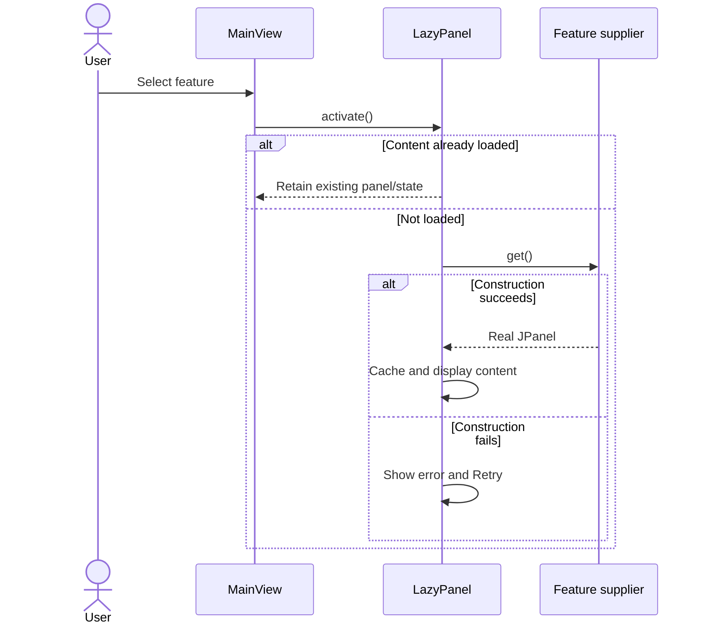

# Architecture and feature integration

## Dependency rule

An arrow means a source-code dependency, not runtime call direction. The shell wires Kevin’s discovery module through its lazy feature factory; other features remain placeholders. ArchUnit allows empty inner packages intentionally at this stage and enforces their dependency rules once classes exist. This is not evidence that unimplemented features follow Clean Architecture.

- `entity`: domain objects and invariants; JDK/domain types only. No Swing, HTTP, Gson, ONNX or repositories.
- `use_case/<feature>`: input boundary, request/response data, interactor, output boundary and small gateway interfaces. Dependencies only on this layer, entities and the JDK. Keep framework-specific details outside.
- `interface_adapter/<feature>`: controller translates user input, presenter implements the output boundary and updates a view model. Own UI-facing interfaces here; do not import concrete Swing views or data-access adapters.
- `data_access/<feature>`: implement use-case-owned ports with HTTP, JSON or other infrastructure. Keep serialization and network types out of inner boundaries.
- `view`: display state and forward events to controllers. No direct calls to interactors, HTTP or repositories. A feature may use SwingWorker here or in its UI adapter to keep I/O off the EDT.
- `app`: choose concrete dependencies and wire them together. Only this layer should know the entire object graph.

A use case may return response data through its input boundary in a synchronous design, but the UI adapter must still keep presentation out of the interactor. Prefer the course output-boundary/presenter structure for new features. Discovery uses synchronous response data through DiscoveryInputBoundary and a separate DiscoveryPresenter in the UI adapter. It does not claim a course-style output-boundary callback from the interactor; that is an explicit tradeoff preserved to keep existing business behavior stable.

## One feature at a time

1. Agree on the user story, owner, input validation and success/failure outcomes in an issue.
2. Agree on shared entity fields and stable IDs with their owners. Do not implement another owner's business rules.
3. Add feature input/output boundaries, request/response DTOs and narrowly scoped gateway interfaces in `use_case/<feature>`.
4. Write the interactor against interfaces; test successful and failure flows with in-memory fakes.
5. Add concrete API/persistence adapters and tests using temporary directories or a local HTTP fixture. No live secrets in tests.
6. Add controller, presenter and view model in `interface_adapter/<feature>`. Keep business decisions in the interactor.
7. Add a Swing panel. Run I/O/inference in a background worker and update Swing on the EDT.
8. Construct dependencies in `app`, and replace only your placeholder factory in `ApplicationFactory`.
9. Run `mvn verify`, manually exercise the feature, update README/diagrams and open a PR linked to the issue. A teammate reviews and merges.

Do not predefine global User/Board/Pin repositories before their owners agree on the contracts. A photo search result is not automatically a saved pin; preference samples are not authenticated boards. Keep these mappings in dedicated adapters. Authentication and ownership enforcement belong in the real account/board integration, not in editable demo IDs.

## SOLID evidence

- **Single Responsibility:** Main starts the app; ApplicationFactory wires dependencies; MainView handles tab selection; LazyPanel controls initialization; each feature owner supplies business behavior separately.
- **Open/Closed:** new feature panels use the same `Supplier<JPanel>` contract; MainView and LazyPanel do not change when a placeholder becomes a real panel. Adding a tab changes composition only.
- **Liskov Substitution:** LazyPanel and real panels satisfy Swing's JPanel contract; loaded panels retain their state when revisited. Feature port implementations must honor documented success/error behavior and be tested against that contract.
- **Interface Segregation:** use feature-specific input/output and gateway boundaries rather than a single all-purpose repository. This remains a requirement for feature PRs, not a completed shell feature.
- **Dependency Inversion:** application logic must depend on use-case-owned ports; composition supplies adapters. The foundation's feature factory depends on `Supplier<JPanel>`, not on a particular feature class. Concrete business-port evidence comes with real use cases.

## Implemented design pattern: Virtual Proxy

`view.LazyPanel` stands in for a real JPanel and holds its creation supplier. `MainView` mounts the proxy immediately, activates it when selected, and keeps the created panel for subsequent visits. This avoids constructing unused feature object graphs (for example optional discovery model resources) and preserves UI state. A failed feature renders an error/retry control while other tabs remain available.

The proxy is a concrete team-authored implementation, not just a reference to Swing's own patterns. Tests verify lazy creation, state retention and failure isolation. Construction occurs on the EDT because Swing components require it; expensive model loading must eventually be split into background initialization if startup latency is noticeable. The proxy does not make blocking work asynchronous.

Reference: [Proxy pattern / virtual proxy](https://refactoring.guru/design-patterns/proxy). **Confirm against your actual lecture material whether Proxy was taught** before claiming it as a pattern not presented in class. The supplied rubric does not list the taught patterns. Kevin's existing embedding cache also demonstrates Decorator; confirm its classroom status separately.

KISS is an additional principle: use a plain map of panel factories and feature-owned interfaces rather than a plugin framework or universal repository. It is not a substitute for the rubric's design-pattern criterion.

## Concrete discovery evidence

See [discovery UML](DISCOVERY_DESIGN.md) for actual classes/interfaces and search/startup flow, and [verification](VERIFICATION.md) for the integration tests. The public application factory uses DiscoveryModule by default; a package-private supplier/configuration seam makes the same composition testable with fixture configuration, without changing machine credentials or connecting to Unsplash. The service algorithms and other owners' features are unchanged.
