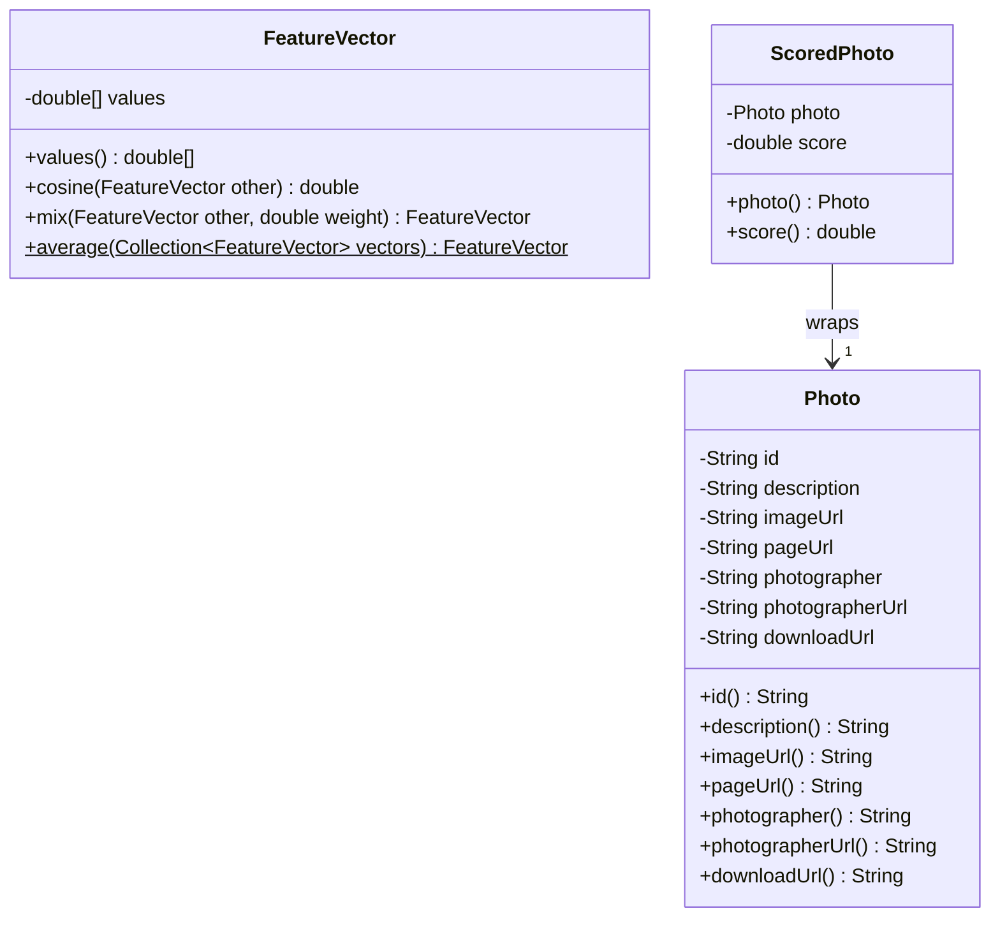

# Discovery design

## Actual entities

These classes are part of the discovery module currently on the team branch. Add the team's account, board, and pin entities here once their class definitions are confirmed.



### Photo

Represents an image from Unsplash and the information needed to display and credit it.

* Fields (all String): `id`, `description`, `imageUrl`, `pageUrl`, `photographer`, `photographerUrl`, and `downloadUrl`.
* Methods: `id()`, `description()`, `imageUrl()`, and `pageUrl()` return the image details. `photographer()` and `photographerUrl()` provide attribution. `downloadUrl()` returns the endpoint for tracking selection.

### FeatureVector

Stores the numerical features that the app uses to compare images.

* Field: `values` is a `double[]` containing the normalized features.
* Methods: `values()` returns a copy. `cosine(other)` compares two vectors, `mix(other, weight)` blends two vectors, and the static method `average(vectors)` combines a collection of vectors into one.

### ScoredPhoto

Pairs a photo with the similarity score used to rank it.

* Fields: `photo` is a `Photo`, and `score` is a `double`.
* Methods: `photo()` and `score()` return the photo and its score.


## Search flow

```mermaid
sequenceDiagram
    actor User
    participant V as DiscoveryView
    participant C as DiscoveryController
    participant U as DiscoveryInputBoundary / DiscoveryService
    participant A as ImageCatalog / UnsplashCatalog
    participant P as DiscoveryPresenter
    User->>V: Search
    V->>C: search(query, page, orientation, order)
    C->>P: busy(true), status(Working)
    P->>V: Disable controls / show status (EDT)
    Note over C,A: SwingWorker background thread
    C->>U: search(...)
    U->>U: Validate inputs
    U->>A: search(...)
    A-->>U: Photos or request error
    U-->>C: Immutable photos or error
    C->>P: cards(photos, null)
    P->>P: Load previews; retain metadata on preview failure
    P-->>C: Cards
    Note over C,V: SwingWorker.done runs on EDT
    alt Search succeeded
        C->>P: show(cards, status)
        P->>V: Render cards
    else Validation or search failed
        C->>P: status(error)
        P->>V: Show actionable error
    end
    C->>P: busy(false)
    P->>V: Enable controls
```

This diagram shows the successful request path with failure completion summarized below it. Validation errors bypass the catalog; request errors bypass card construction. A failed preview only affects its thumbnail. The service returns response data; it does not invoke the presenter. All infrastructure is supplied by `app.DiscoveryModule`.
