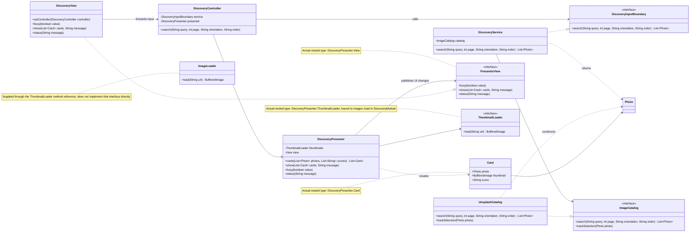
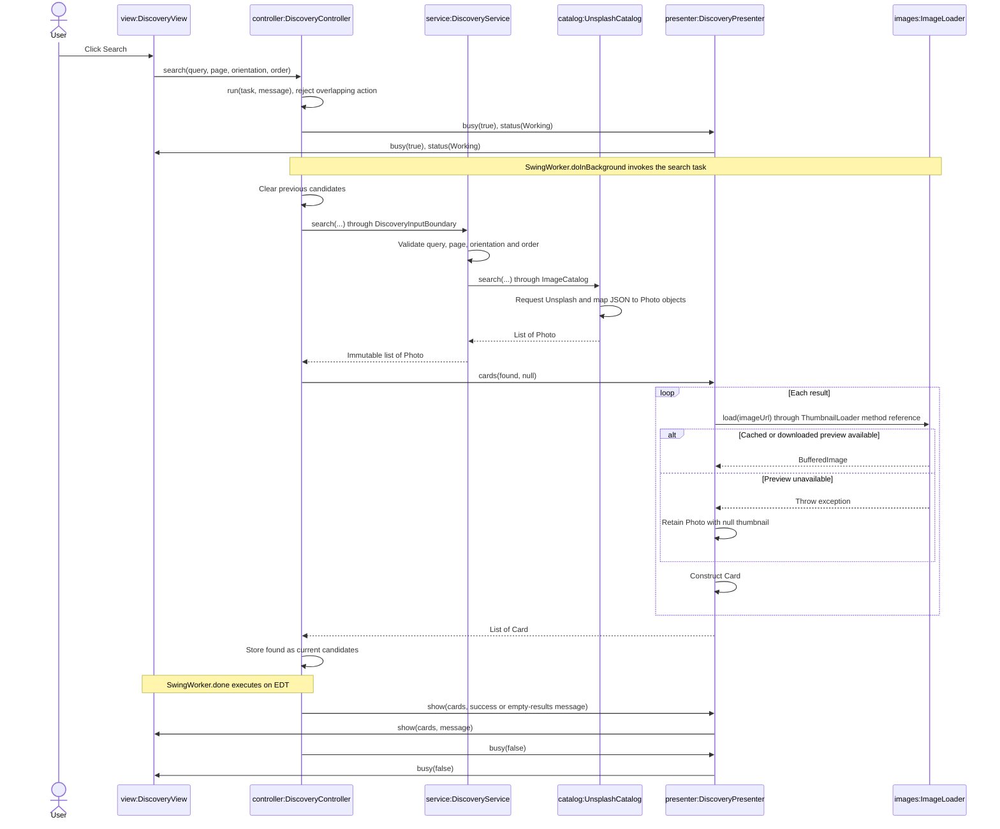
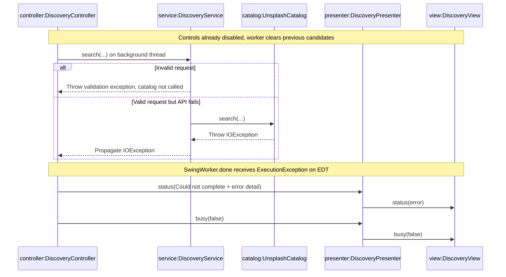
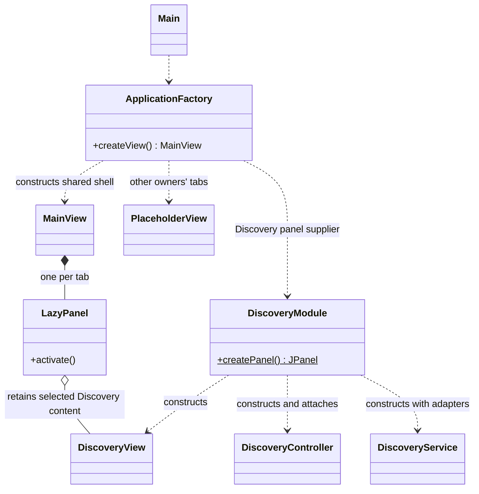
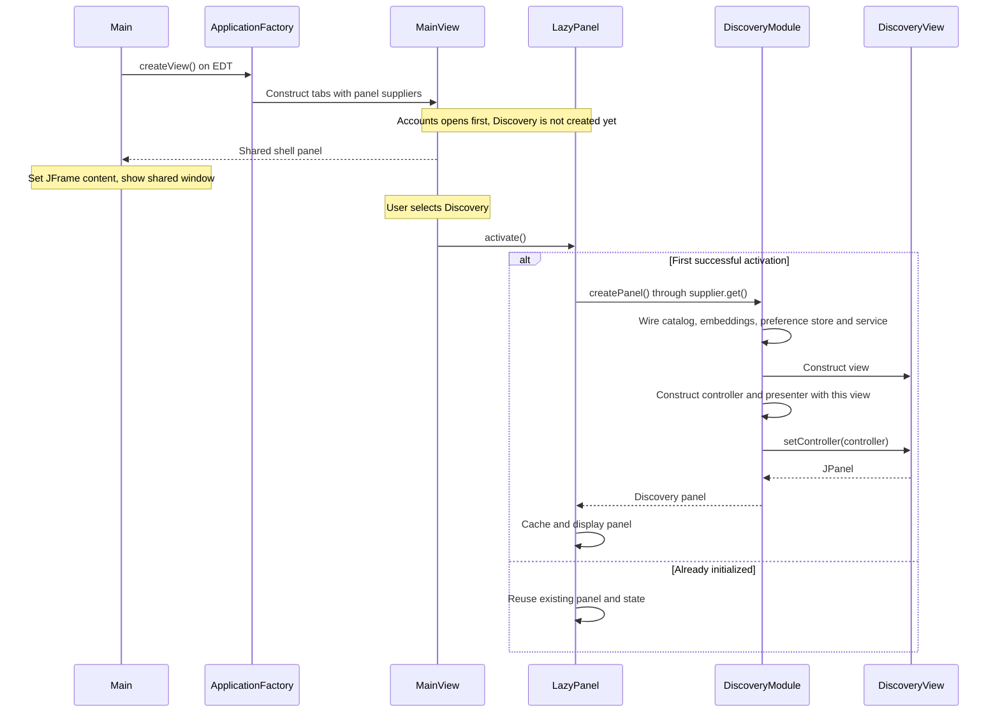
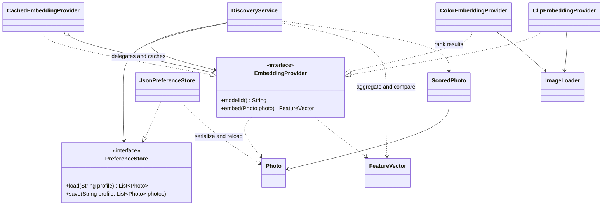
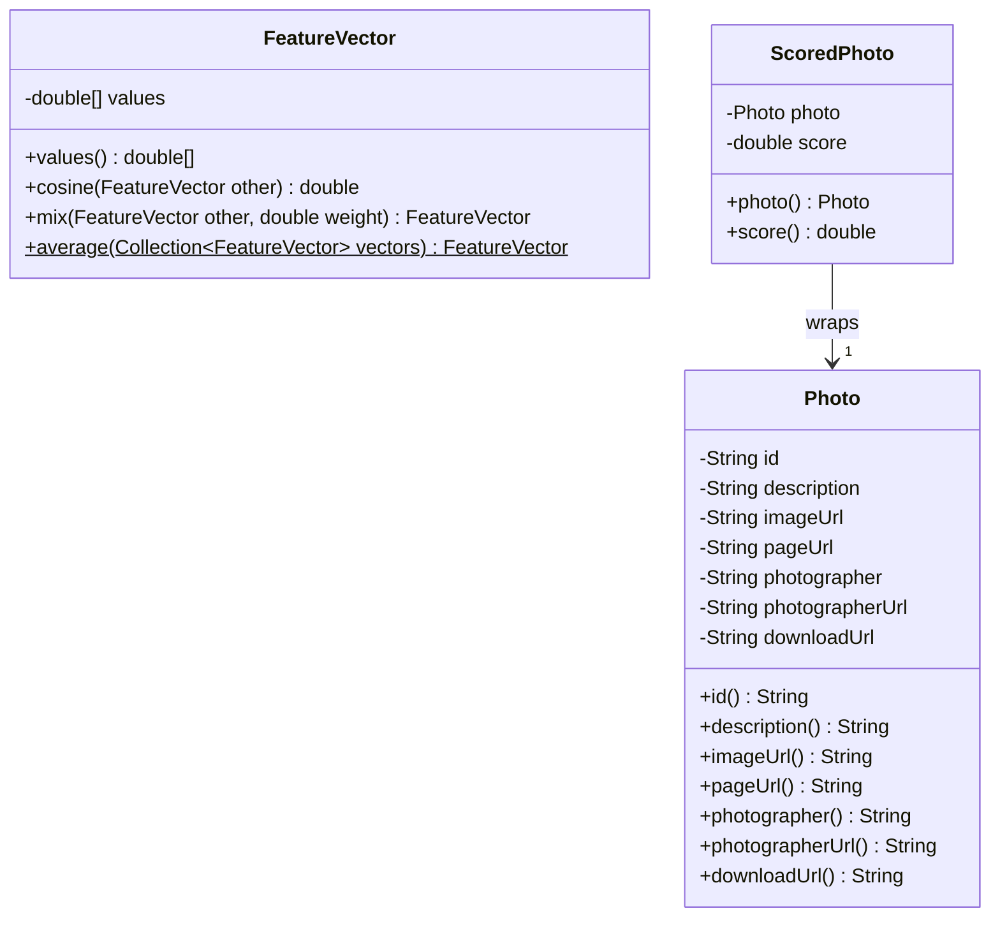

# Discovery UML and skeleton integration

## What each diagram covers

A **class diagram** shows types, their responsibilities, and their dependencies. A **sequence diagram** shows the objects taking part in one particular interaction, in time order. It does not need every project class. Every application participant in the search sequence below appears in the search class diagram, startup and recommendation/persistence types have separate diagrams. JDK Swing/HTTP internals, Gson and ONNX internals are omitted for readability.

The previous diagram covered only the three entity types. That was an entity diagram, not enough to explain the complete discovery use case or its integration with the skeleton.

## 1. Search use-case class diagram

This is a search slice: only the search operation is listed on the input boundary/service, their recommendation operations and ports are shown below. Arrows are source dependencies, not a claim that the service calls the presenter. `DiscoveryService` returns data through `DiscoveryInputBoundary`, the controller then uses `DiscoveryPresenter`. This synchronous response design is an explicit variation from an interactor calling an output-boundary callback. No separate output boundary or view-model class is invented in this diagram.

## 2. Successful search sequence

Precondition: the Discovery tab is already initialized. Everything before the background-thread note runs on Swing's event dispatch thread (EDT). The background search task and its completion callback are owned by the controller's anonymous `SwingWorker`, the worker and JDK executor are omitted as separate lifelines.

`Photo` and `Card` are returned data objects, so they do not need lifelines of their own here. `FeatureVector`, embedding providers and the preference store are not called by keyword search, they belong in recommendation/save sequences. `Main`, the application factory and lazy shell panels belong in the startup sequence below, not in every search interaction.

## 3. Search failure sequence

No cards are built and candidates remain empty after validation/API failure. A preview-only failure follows the successful-search sequence and keeps the photo/attribution available. Cancellation has its own `InterruptedException` handling in the controller.

## 4. Skeleton startup and integration

If module construction fails, `LazyPanel` shows the configuration error and Retry while other tabs remain usable. Optional CLIP initialization can take time on first activation, the proxy delays construction but does not make it asynchronous.

The app starts at `app.Main` from Maven, uses the skeleton's `MainView` and `LazyPanel`, and replaces only the Discovery factory. There is no restored standalone `DiscoveryApplication` entry point and no runtime checkout, read or dependency on a Git branch.

`kevin_working` is an unchanged historical backup at `1cdd12d817b281ba80dbe2d84c8cc379e8a27f1a`. The shared skeleton was published first at `01a32869d53ef368c899fb44600ad0a95b52b528`, PR #10 is a descendant of that commit. Run the PR branch to exercise the integrated feature, do not run or merge the backup as the active application.

## 5. Recommendation, embedding and persistence dependencies

The default embedding strategy is a normalized RGB histogram, optional CLIP uses an external compatible model. `CachedEmbeddingProvider` is a Decorator over either provider. Real account ownership, pins and boards remain their assigned teammates' work, demo preference IDs are not authentication or a board repository.

## 6. Entity detail

`Photo` carries Unsplash metadata and attribution. `FeatureVector` validates and normalizes vectors and returns copies of its values. `ScoredPhoto` pairs metadata with a similarity score. Cosine similarity is not a probability or percentage accuracy.
