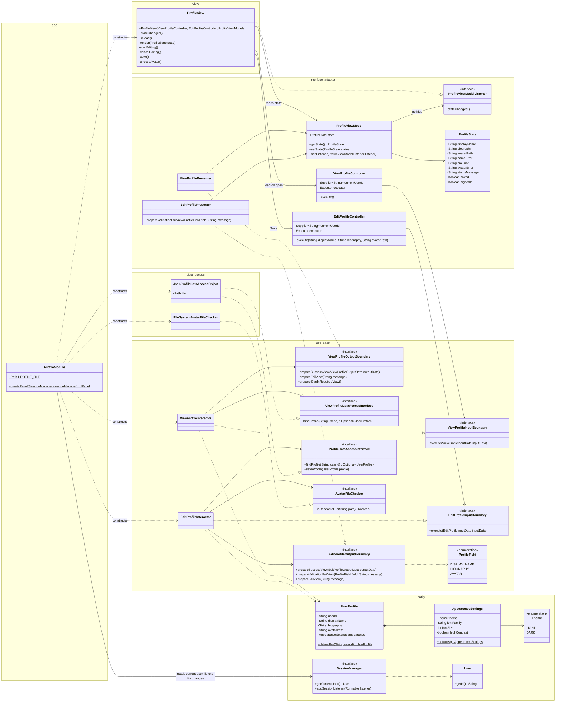
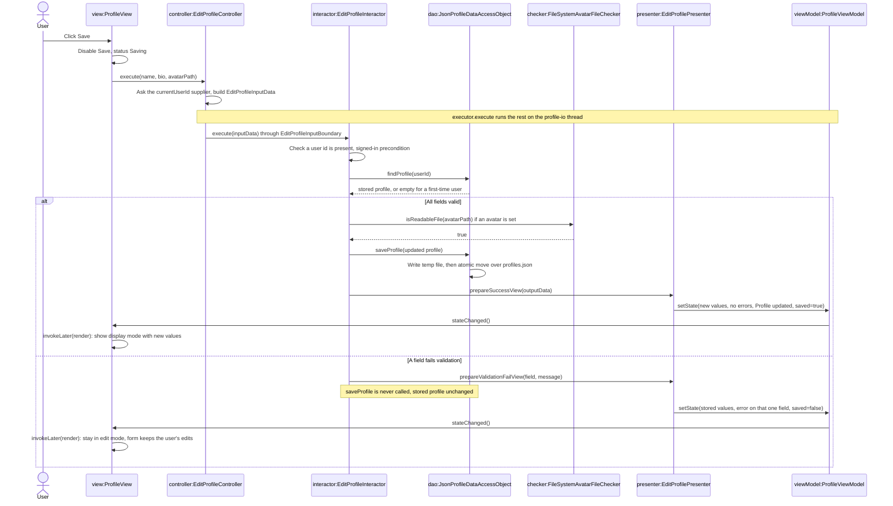
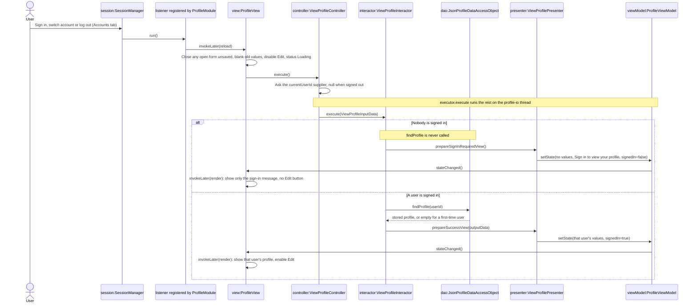

# Profile customization (User Story 6): design and UML

Owner: Kieran Murphy. User story 6: *As a user, I want to customize my profile and appearance settings so that I can personalize my experience.*

This document covers the two implemented use cases, **View Profile** (load and show the stored profile) and **Edit Profile** (the MVP use case). The stretch use case **Change Appearance** (theme, font size) is not implemented yet. `AppearanceSettings` already exists on the entity and is carried forward unchanged by every edit.

## What each diagram covers

The **class diagram** shows every application type in the feature, grouped by Clean Architecture layer, and the source-code dependencies between them. The **sequence diagrams** each show one interaction in time order: Save in the edit form, with an `alt` block for the success and validation-failure branches, and the reload after a sign-in, account switch or logout, with an `alt` block for signed in and signed out. JDK Swing internals and Gson are omitted for readability.

## 1. Edit Profile use case

**Actor:** a signed-in user (signed in through Matthew's Accounts tab).
**Precondition:** the user is signed in and the Profile tab is open (View Profile has loaded their stored profile, or a default one).

### Main flow

1. The user opens the Profile tab. The system shows the stored display name, biography and avatar file name.
2. The user clicks **Edit Profile**.
3. The system shows a form pre-filled with the current display name, biography and avatar path.
4. The user edits any of the fields, optionally choosing an avatar with **Browse…** (only `.png`, `.jpg` and `.jpeg` files are offered).
5. The user clicks **Save**. The system validates the values.
6. The system saves the profile and returns to display mode, showing the updated profile and the message **"Profile updated"**.

### Validation rules (checked in `EditProfileInteractor`)

| Field | Rule | Error shown under the field |
|---|---|---|
| Display name | required, trimmed, at most 30 characters | "Display name is required." / "Display name must be 30 characters or fewer." |
| Biography | at most 300 characters, may be empty | "Biography must be 300 characters or fewer." |
| Avatar | empty, or an existing readable file ending in `.png`, `.jpg` or `.jpeg` | "Avatar must be a .png, .jpg, or .jpeg file." / "Avatar file could not be found." |

### Alternate flows

- **1a. First-time user (no stored profile):** the system shows a default profile (display name "New user", empty biography, no avatar). The first save creates the stored profile, nothing errors.
- **1b. Stored profile can't be read:** the system shows "Couldn't load your profile, try again".
- **1c. Not signed in:** the tab shows only "Sign in to view your profile". No profile is shown, there is no Edit Profile button, and nothing is read from storage.
- **1d. Account switch or logout while the tab is open:** the tab reloads for the newly signed-in user, or shows the sign-in message after a logout. An open edit form is discarded, never saved, so one account's edits can't land on another account.
- **4a. Cancel:** the user clicks **Cancel**. The edits are discarded, nothing is saved, and the view returns to the stored values.
- **5a. Invalid display name:** the error appears next to the name field. The form stays open with all of the user's edits. Nothing is saved.
- **5b. Biography too long:** the error appears next to the biography. Nothing is saved.
- **5c. Bad avatar (wrong extension or missing file):** the error appears next to the avatar field. The old avatar is kept. Nothing is saved.
- **6a. Save fails (`IOException`):** the system shows "Couldn't save your changes, try again". The form stays filled so the user can retry.

**Postconditions:** on success, the stored profile equals the new values. On any failure, the stored profile is unchanged.

## 2. Class diagram (all layers)



Input data and output data classes (`ViewProfileInputData`, `ViewProfileOutputData`, `EditProfileInputData`, `EditProfileOutputData`) are omitted as boxes to keep the diagram readable. They are plain carriers of the fields named in the boundary methods. Every arrow points inward or across a boundary interface: the view knows only the controllers and the view model, the interactors know only interfaces and entities, and only `ProfileModule` knows the concrete classes. `SessionManager` and `User` are Matthew's, shown only for how Profile uses them, and only `ProfileModule` touches them.

## 3. Save sequence

Precondition: the user is in edit mode. Everything up to the background-thread note runs on Swing's event dispatch thread (EDT). The controller hands the interactor call to the single `profile-io` executor thread, the view switches back to the EDT with `SwingUtilities.invokeLater` before touching any component.



The save-failure branch (6a) follows the success branch up to `saveProfile`, which throws `IOException`. The interactor then calls `prepareFailView("Couldn't save your changes, try again")` and the view stays in edit mode exactly as in the validation branch. View Profile follows the same path with `ViewProfileController`, `ViewProfileInteractor` and `ViewProfilePresenter`, minus validation and saving.

## 4. Sign-in, account switch and logout sequence

The Profile panel is built once, the first time its tab opens (`LazyPanel`), so it must react when the account changes afterwards. `ProfileModule` registers a listener on Matthew's `SessionManager`. The session may notify from any thread, so the listener only queues `reload()` on the EDT.



Opening the tab for the first time follows the same path from `reload()`, which the view's constructor calls.

## 5. Design decisions

- **Validation lives in the interactor, not the entity.** Entity constructors only do non-null checks, trimming and safe defaults. Rules that the user should see as a message next to a field (required, maximum length, avatar format and existence) are application rules, so `EditProfileInteractor` checks them and reports a `ProfileField`. `AppearanceSettings` does keep its font-size bound (10 to 24), because that is a rendering invariant rather than a form error.
- **Two data-access interfaces, one DAO (Interface Segregation).** View Profile depends on the read-only `ViewProfileDataAccessInterface`, Edit Profile on `ProfileDataAccessInterface` (read and save). `JsonProfileDataAccessObject` implements both with one `findProfile` method. Neither use case package depends on the other.
- **`AvatarFileChecker` (Dependency Inversion).** The interactor asks an interface whether the avatar file exists, so its tests use an in-memory fake and never touch the real filesystem. `FileSystemAvatarFileChecker` is the real implementation in `data_access`.
- **`ProfileState` holds the stored values.** The name, biography and avatar in the state are always what is saved. The edit form's text belongs to the view. That is what makes Cancel (4a) restore the stored values and what lets a failed save keep the user's edits on screen.
- **The `saved` flag.** After Save, the view must decide whether to leave edit mode. A successful save and a failed save both have no field errors, so the presenter sets `saved=true` only on success instead of the view comparing message text.
- **Threading.** Controllers run the interactor on an `Executor` because `interface_adapter` may not depend on Swing (enforced by `DependencyRuleTest`). The executor is a single daemon thread: a load and a save never overlap, and the thread never keeps the app running after the window closes. The view model's state is `volatile` and its listener list is a `CopyOnWriteArrayList` because presenters update them from that thread.
- **Reading the signed-in user.** Only `ProfileModule` reads Matthew's `SessionManager`. It gives each controller a `Supplier<String>` that returns the current user's id, or `null`. Controllers call it on every request, not once at construction, because the tab is built once and outlives sign-ins and account switches. The interactors never see the session, only the id in their input data, and they treat a missing id as "not signed in" because being signed in is the use case's precondition. `ProfileState.signedIn` tells the view to show the sign-in message instead of a profile.
- **Observer pattern.** `ProfileViewModel` notifies `ProfileViewModelListener`s, the same pattern as Alex's `SavePinViewModel`. The view model depends only on the listener interface, not on `ProfileView`.

## 6. Integration and running

- `ProfileModule.createPanel(sessionManager)` is the only wiring code. `ApplicationFactory` changed exactly one line: `features.put("Profile", () -> ProfileModule.createPanel(sessionManager));`, sharing the same session as the other tabs. The tab is created lazily by `LazyPanel` like every other tab.
- Profiles belong to the signed-in account: each profile is stored under that account's user id from Matthew's `User.getId()`. Signed out, nothing is read or saved.
- Profiles are stored in `data/profiles.json` (gitignored), one JSON object keyed by user id, written atomically (temp file, then move). A missing file means no profiles yet. A corrupt file is reported as "Couldn't load your profile, try again" instead of crashing.

```json
{
  "0b6f9c2e-1d4a-4c51-9a7e-3f2b8d6e7a10": {
    "displayName": "Kieran",
    "biography": "I like photos",
    "avatarPath": "/Users/me/Pictures/me.png",
    "theme": "LIGHT",
    "fontFamily": "SansSerif",
    "fontSize": 14,
    "highContrast": false
  }
}
```

**Demo:** `mvn compile exec:java`. Open the Profile tab while signed out and it shows "Sign in to view your profile". Sign in on the Accounts tab and Profile shows that account's profile. Click Edit Profile, change the name and Save. Close the app, start it again, sign in, and the new name is still shown. Sign in as a second account and Profile shows that account's own profile.

## 7. Tests

| Test class | What it shows |
|---|---|
| `entity.UserProfileTest`, `entity.AppearanceSettingsTest` | Entity defaults, trimming, null handling, font-size bounds, `defaultFor` |
| `use_case.edit_profile.EditProfileInteractorTest` | Valid save, blank name, name over 30, bio over 300, bad avatar extension, missing avatar file, failure leaves the stored profile unchanged, first edit with no stored profile, appearance carried forward unchanged, load and save `IOException`, not signed in touches no storage |
| `use_case.view_profile.ViewProfileInteractorTest` | Stored profile shown, missing profile shows the default, read failure message, not signed in (null or blank id) asks to sign in without reading storage |
| `data_access.JsonProfileDataAccessObjectTest` | Save, then a new DAO on the same file loads it, missing file, corrupt file |
| `data_access.FileSystemAvatarFileCheckerTest` | Real file, missing file, directory, blank path |
| `interface_adapter.profile.*PresenterTest` | Success clears errors and sets "Profile updated" and `saved`, each `ProfileField` sets only its own error, edit failures keep the stored values, a failed load clears the previous values, the sign-in state hides the profile |
| `interface_adapter.profile.*ControllerTest` | The interactor only runs on the executor, with the right user id and form values; the signed-in user is read when the request is made, `null` when signed out |
| `interface_adapter.profile.ProfileViewModelTest` | Listeners are notified on every state change |
| `app.ProfileModuleTest` | Real wiring with a real session on a `@TempDir` file: signed out shows only the sign-in message, the signed-in user's stored profile is shown, a first-time user sees "New user", signing in after opening the tab loads that user, switching accounts mid-edit shows the new user and saves nothing, logout hides the profile, Edit then Save writes the file and a new panel reloads it, blank name shows the error and saves nothing, Edit and Cancel are disabled while loading and saving |
