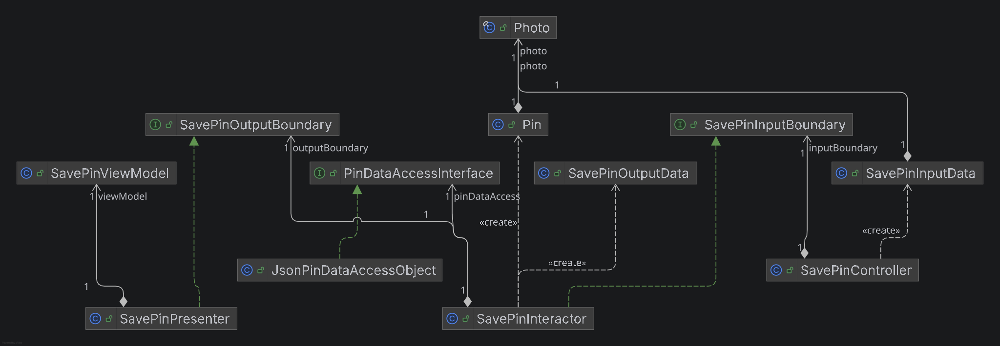
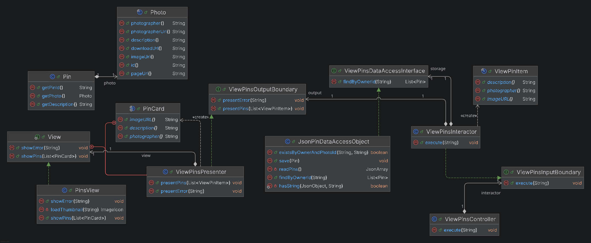
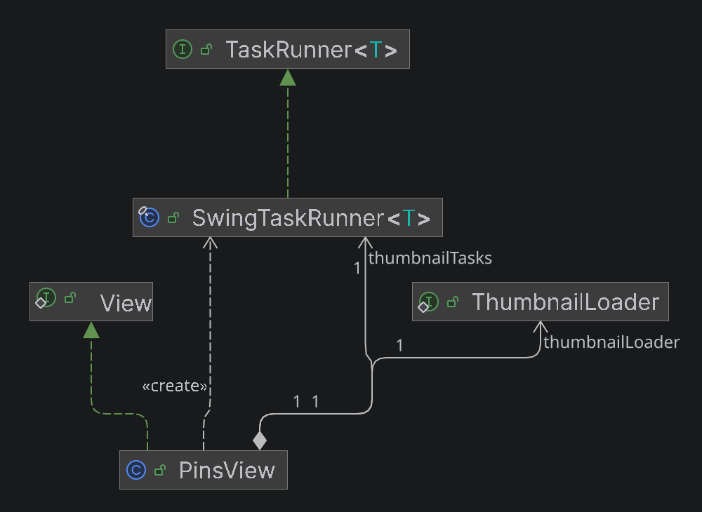

# Pin Management Design

## Figure 1. Save Pin core

`SavePinInteractor` uses `PinDataAccessInterface` to check `existsByOwnerAndPhotoId(...)` before calling `save(pin)`. `JsonPinDataAccessObject` implements that interface, so the interactor can save a pin without depending on JSON storage.
The interactor reports success, a duplicate, or a failure through `SavePinOutputBoundary`, which `SavePinPresenter` implements. On a first save, the interactor reports success only after `save(pin)` returns successfully.
## Figure 2. Save Pin in Discovery

The Save button invokes `SaveAction.save(photo)`. `DiscoveryModule` supplies the callback that checks the current user. When the user is signed in, the callback passes `user.getId()` and the selected photo to `SavePinController`.

**Observer pattern.** `SavePinViewModel` is the subject, and `DiscoveryView` registers itself as an observer with `addListener(this)`. When `SavePinPresenter` calls `setState(...)`, the view model calls `stateChanged()` on each listener. `DiscoveryView` then calls `getState()` to read the result. The view model depends only on `SavePinViewModelListener` to notify observers.

## Figure 3. View Pins

When the Pins tab becomes visible, a listener configured by `ApplicationFactory` reads the current user. If the user is signed in, it passes `user.getId()` to `ViewPinsController`. Reopening the tab after switching accounts therefore triggers a lookup for the newly signed-in user.

**Loading saved pins.** `ViewPinsInteractor` calls `findByOwnerId(...)` through `ViewPinsDataAccessInterface`. `JsonPinDataAccessObject` reads the saved pins for that owner from the JSON file. The interactor reads each pin’s `Photo` through `getPhoto()` and creates a `ViewPinItem`. The presenter converts those items into cards and calls `showPins(...)` to display them.

## Figure 4. Loading thumbnails in Pins

`PinsView` displays the pin cards immediately and uses `SwingTaskRunner` to load and scale thumbnails in the background. It tracks in-flight image URLs so reopening the tab can reuse a pending download. When a load finishes, the view checks whether a visible card still uses that URL before repainting.