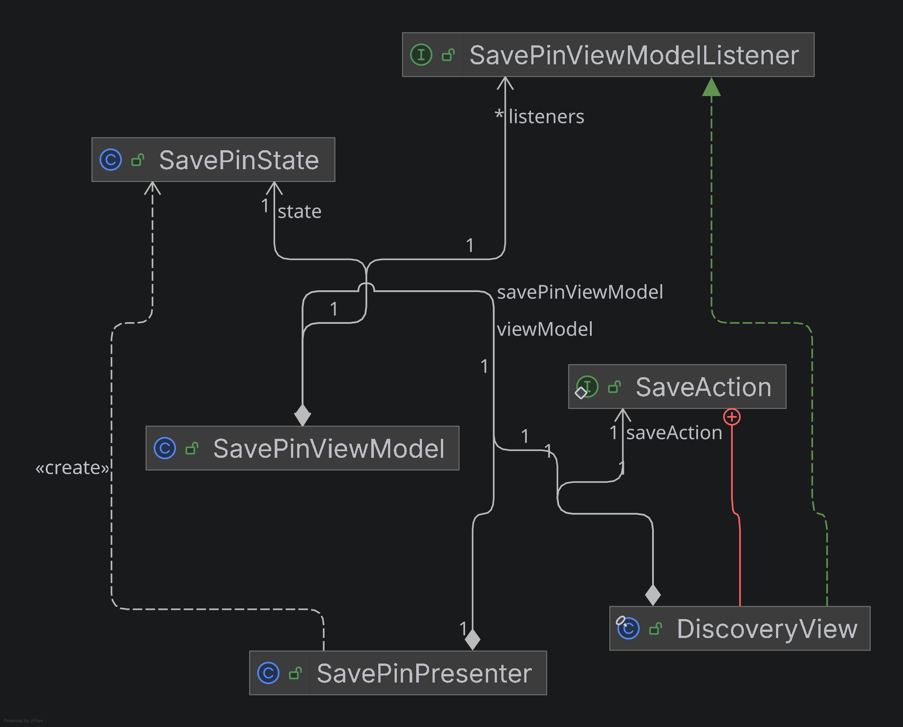
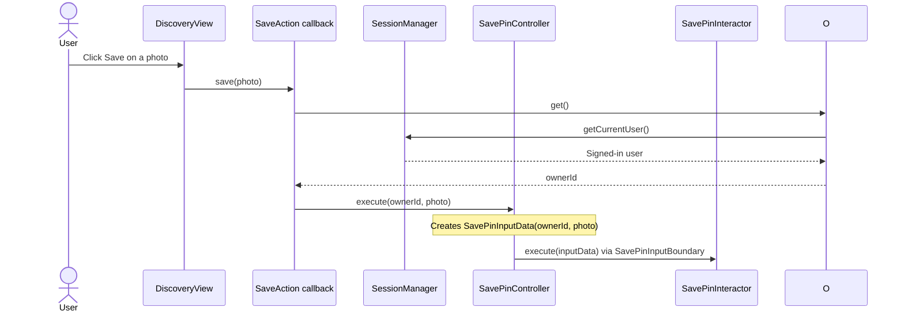
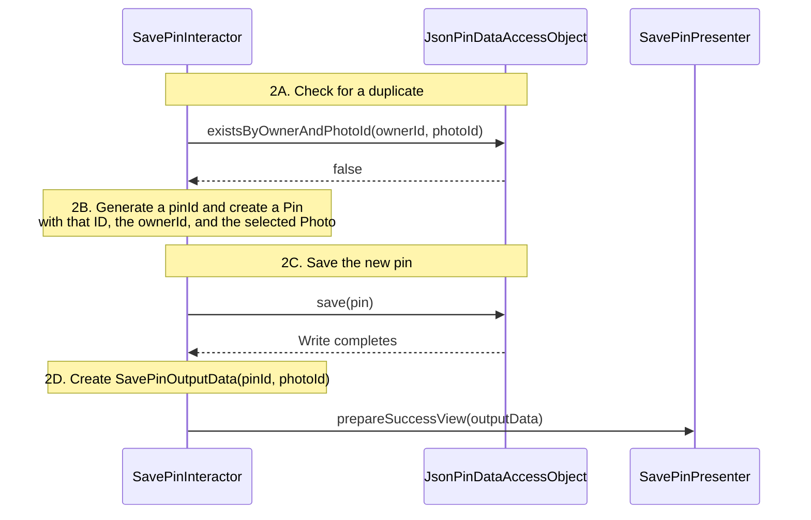
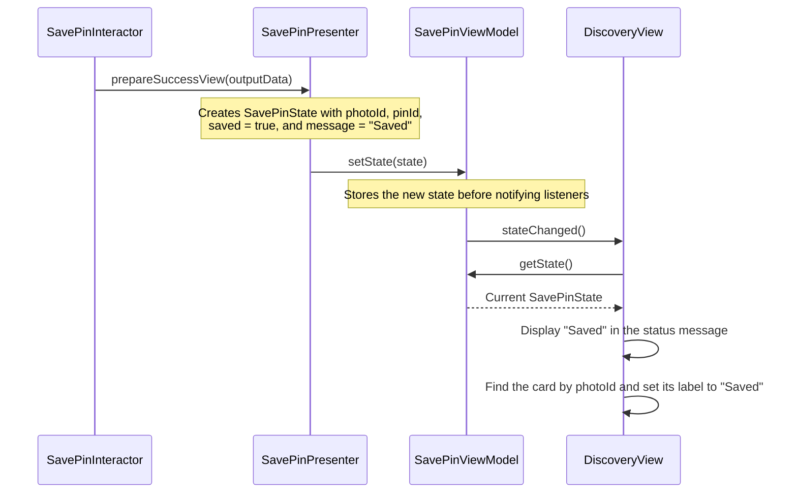
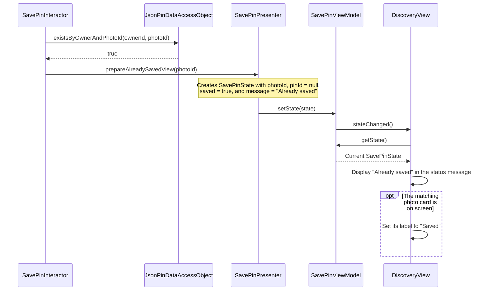
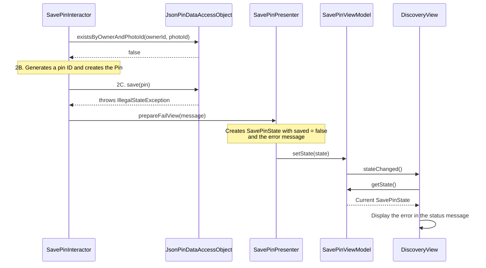
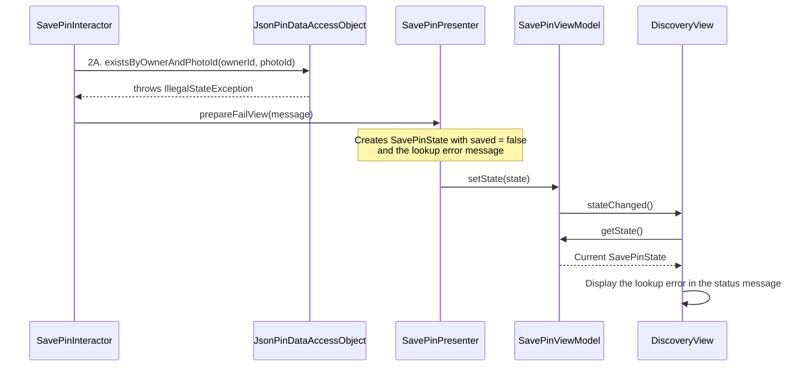
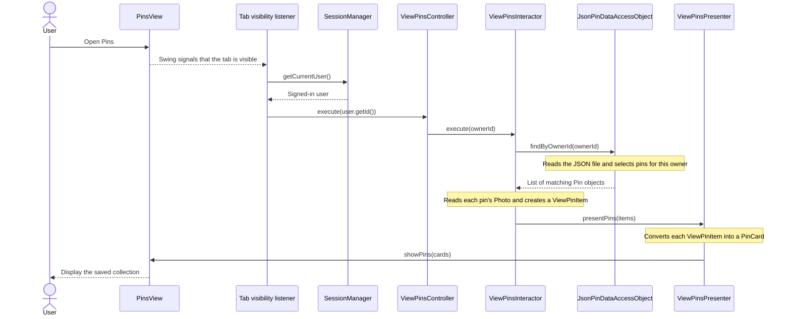

# Pin Management Design

## Figure 1. Save Pin core

`SavePinInteractor` uses `PinDataAccessInterface` to check `existsByOwnerAndPhotoId(...)` before calling `save(pin)`. `JsonPinDataAccessObject` implements that interface, so the interactor can save a pin without depending on JSON storage.
The interactor reports success, a duplicate, or a failure through `SavePinOutputBoundary`, which `SavePinPresenter` implements. On a first save, the interactor reports success only after `save(pin)` returns successfully.
## Figure 2. Save Pin in Discovery

The Save button invokes `SaveAction.save(photo)`. `DiscoveryModule` supplies the callback that checks the current user. When the user is signed in, the callback passes `user.getId()` and the selected photo to `SavePinController`.

**Observer pattern.** `SavePinViewModel` is the subject, and `DiscoveryView` registers itself as an observer with `addListener(this)`. When `SavePinPresenter` calls `setState(...)`, the view model calls `stateChanged()` on each listener. `DiscoveryView` then calls `getState()` to read the result. The view model depends only on `SavePinViewModelListener` to notify observers.

## Figure 3. View Pins

When the Pins tab becomes visible, a listener configured by `ApplicationFactory` reads the current user. If the user is signed in, it passes `user.getId()` to `ViewPinsController`. Reopening the tab after switching accounts therefore triggers a lookup for the newly signed-in user.

**Loading saved pins.** `ViewPinsInteractor` calls `findByOwnerId(...)` through `ViewPinsDataAccessInterface`. `JsonPinDataAccessObject` reads the saved pins for that owner from the JSON file. The interactor reads each pin’s `Photo` through `getPhoto()` and creates a `ViewPinItem`. The presenter converts those items into cards and calls `showPins(...)` to display them.

## Figure 4. Loading thumbnails in Pins

`PinsView` displays the pin cards immediately and uses `SwingTaskRunner` to load and scale thumbnails in the background. It tracks in-flight image URLs so reopening the tab can reuse a pending download. When a load finishes, the view checks whether a visible card still uses that URL before repainting.

## Figure 5. Save Pin request (Part 1)

A signed-in user clicks **Save** on a photo in Discovery. `DiscoveryModule` supplies the callback that reads the current user and passes their ID and the selected photo to `SavePinController`.

## Figure 6. Saving a pin for the first time (Parts 2A–2D)

The interactor reads the owner ID and the selected photo’s ID from `inputData`. In this scenario, the owner has never saved this photo.

The interactor calls the DAO through `PinDataAccessInterface` and the presenter through `SavePinOutputBoundary`. It reports success only after `save(pin)` returns.

## Figure 7. Discovery displays “Saved” (Part 3)

After the pin is saved, `SavePinPresenter` creates the state that Discovery will display. `DiscoveryView` registered itself earlier as a `SavePinViewModelListener` with `addListener(this)`.

This is the Observer pattern. `stateChanged()` takes no arguments. It tells Discovery when to read the view model. `getState()` supplies the message to display and the photo ID that identifies which card to update.

## Figure 8. Discovery reports an already-saved photo (Part 4A)

The signed-in user clicks **Save** on a photo they have already saved. The request reaches the interactor as in Figure 5.

The duplicate lookup returns only a boolean, so the presenter receives the photo ID but no existing pin ID. Discovery uses the photo ID to update the matching card. The interactor returns without creating another `Pin` or calling `save(pin)`.

## Figure 9. Saving the new pin fails (Part 4B)

The duplicate check at step 2A returns `false`. The interactor creates a `Pin` at 2B, but the attempt to write it to storage fails at 2C.

Discovery displays **“Could not save the pin. Please try again.”** The `Pin` exists in memory, but the failed write prevents the interactor from reaching step 2D. Since the failure state has `saved = false`, Discovery leaves the card’s label unchanged.

## Figure 10. The duplicate check fails (step 2A)

The user clicks **Save**, but the storage lookup fails before the interactor can determine whether this owner already saved the photo.

Discovery displays **“Could not check whether the photo is already saved. Please try again”** and leaves the card’s label unchanged. The interactor returns at 2A, before it creates a `Pin` at 2B or calls `save(pin)` at 2C.

## Figure 11. Viewing saved pins after restarting Photofy

**Precondition.** The user previously saved a pin, restarted Photofy, and signed back into the same account.

`ApplicationFactory` registers the visibility listener when it builds the Pins panel. Each time the tab becomes visible, the listener reads the current user. After a restart, that user's ID lets the DAO retrieve the pin written in Figure 6 from the JSON file.
